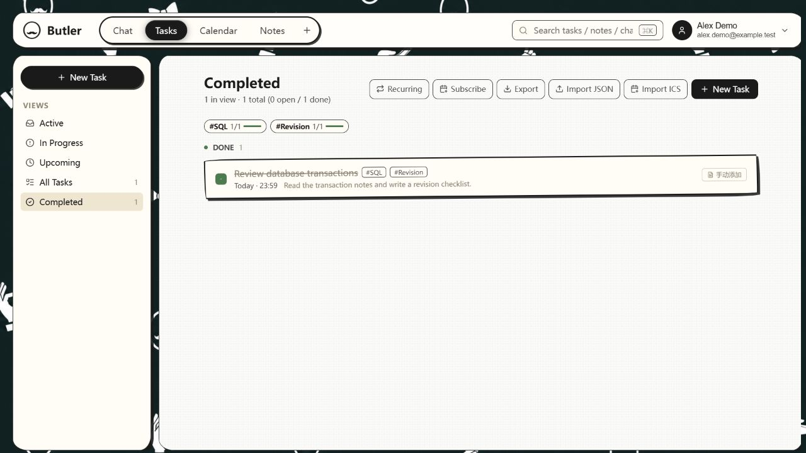

# Butler demo walkthrough

[Download source from main](https://github.com/frankrainrp/Bulter/archive/refs/heads/main.zip)

## Watch the recorded walkthrough

This 21-second recording shows the real Butler application with fictional study data. English mode is selected; some original labels remain in Chinese.

[](assets/butler-real-page-demo.mp4)

[Watch MP4](assets/butler-real-page-demo.mp4) · [Download MP4](https://raw.githubusercontent.com/frankrainrp/Bulter/main/docs/assets/butler-real-page-demo.mp4) · [English captions](assets/butler-real-page-demo.en.vtt)

## Recorded steps

1. Open **Tasks** and select **New Task**.
2. Enter **Review database transactions** as the title. Keep the default due date and time, choose **High** priority, and add the **SQL** and **Revision** tags.
3. Enter **Read the transaction notes and write a revision checklist.** as the description, then select **Create**.
4. Open **Calendar** and view the saved task.
5. Return to **Tasks**, select **Mark as done**, and open **Completed**.
6. Reload the browser page, return to **Tasks**, and open **Completed** again. The same task remains completed.

The clip demonstrates manual task creation, the calendar view, completion, and persistence after reloading. It does not include a generated AI reply.

## Start the application

Use Node.js 20 or newer and pnpm 9, as specified by the workspace. After extracting the ZIP, open a terminal in `Bulter-main/my-app`:

```sh
corepack enable
corepack prepare pnpm@9.0.0 --activate
pnpm install --frozen-lockfile
pnpm dev
```

Open the local address printed by the development server. Create a local demo account, then choose English in the language control or Preferences.

The application workspace is `my-app/`. The separate MCP server is in `butler-mcp/`; it is not required for this walkthrough. To repeat the recorded task flow, use fictional records in a fresh browser profile or a separate local origin.

## Optional features

The current main routes chat through the OpenAI SDK to a configured DeepSeek endpoint. Model-backed chat, extraction, and research require their service configuration; OCR also has a separate provider configuration. This walkthrough does not include an inference result.

The standalone MCP server exposes tools through a separate JSON vault. Connecting it does not automatically turn the browser's IndexedDB records into shared live server data.

## Where records are stored

SQLite stores login accounts and sessions. Tasks, notes, and workspace records in this version are held in browser IndexedDB. Use the same browser origin to follow the saved task after reloading.

## Source references

- [Application workspace and setup](https://github.com/frankrainrp/Bulter/tree/main/my-app)
- [Tasks panel](https://github.com/frankrainrp/Bulter/blob/main/my-app/apps/web/src/components/TasksPanel.tsx)
- [Calendar panel](https://github.com/frankrainrp/Bulter/blob/main/my-app/apps/web/src/components/CalendarPanel.tsx)
- [Browser storage](https://github.com/frankrainrp/Bulter/blob/main/my-app/apps/web/src/lib/db.ts)
- [Chat route](https://github.com/frankrainrp/Bulter/blob/main/my-app/apps/web/src/app/api/chat/route.ts)
- [Separate MCP server](https://github.com/frankrainrp/Bulter/tree/main/butler-mcp)
